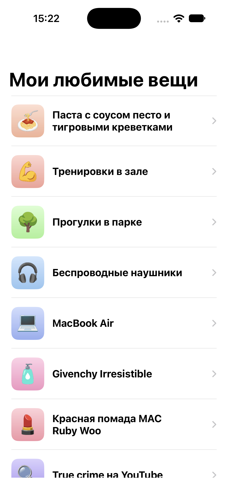
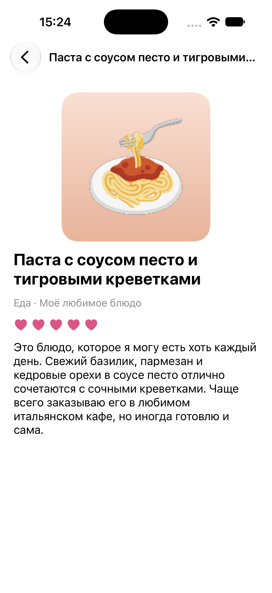
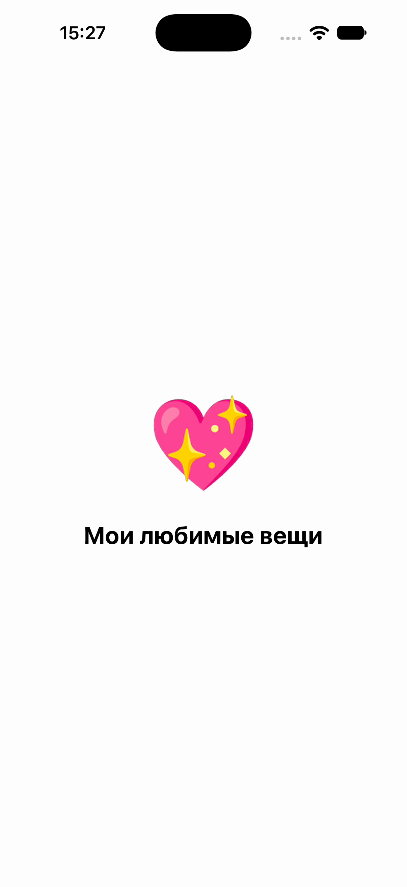
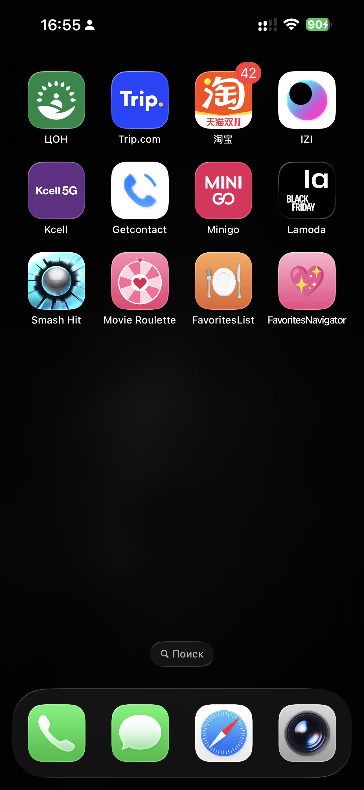

# Lab 10 · Favorites Navigator

**Student:** Мешитбек Сагыныш Медеуханкызы
**Theme:** Мои любимые вещи (my favorite things)

A UIKit app with a list of 21 of my favorite things: food, sport, gadgets, beauty and hobbies. The list lives inside a `UINavigationController`. Tapping a row opens a Detail screen with a large image, title, subtitle, a rating drawn with SF Symbols (hearts) and a description.

## How it works

- Everything is built in `Main.storyboard`: the navigation controller (initial view controller, Prefers Large Titles), the list, the Detail screen, the Show segue `showDetail` and all Auto Layout.
- `FavoriteItem` (struct) describes one item; `FavoritesLibrary.items` keeps the whole list in one place.
- The list passes only data in `prepare(for:sender:)`: it checks the segue identifier, casts `segue.destination` to `DetailViewController` and takes the row from `tableView.indexPathForSelectedRow`.
- `DetailViewController` has `var item: FavoriteItem?` and fills its own outlets in `viewDidLoad`.
- The tapped row is deselected in `viewWillAppear` when returning to the list.
- Custom App Icon and a Launch Screen with the app logo on the system background (works in Dark Mode).

## Screenshots

| List | Detail |
|---|---|
|  |  |

| Launch Screen | App Icon on the Home Screen |
|---|---|
|  |  |
