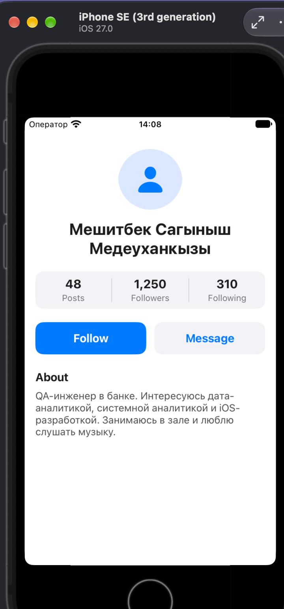
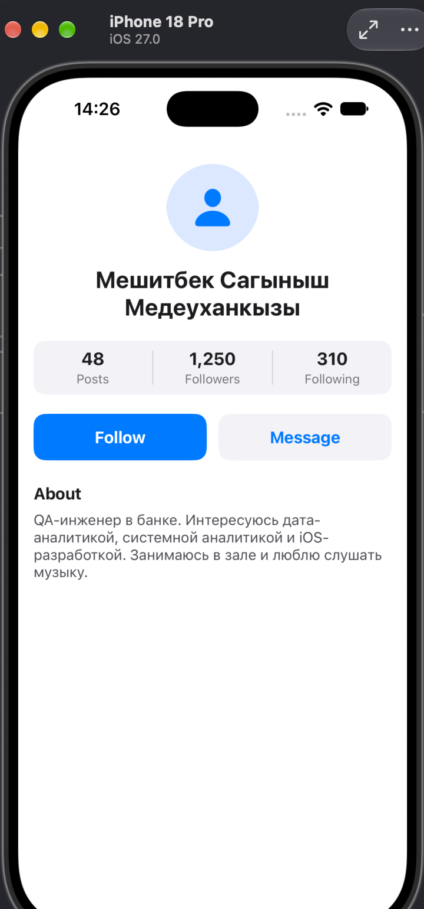

# Lab 7 · Profile Screen (Variant A)

A profile screen built in UIKit with a Storyboard only. Every view and every constraint is set in Interface Builder; no `UIStackView`. Swift code only fills in the data.

## Layout

- Avatar: 96 × 96 circle, centered
- Name: up to 2 lines, centered
- Stats: 3 equal columns (Equal Widths) with dividers
- Follow and Message: equal widths, 12 pt apart, 48 pt tall
- About: wraps with no line limit
- 16 pt side margins, all content inside the safe area

## Screenshots

| iPhone SE (3rd generation) | iPhone 18 Pro Max |
|---|---|
|  |  |

iPhone 18 Pro is used instead of iPhone 16 Pro Max, which is not available in the iOS 27 simulator.
