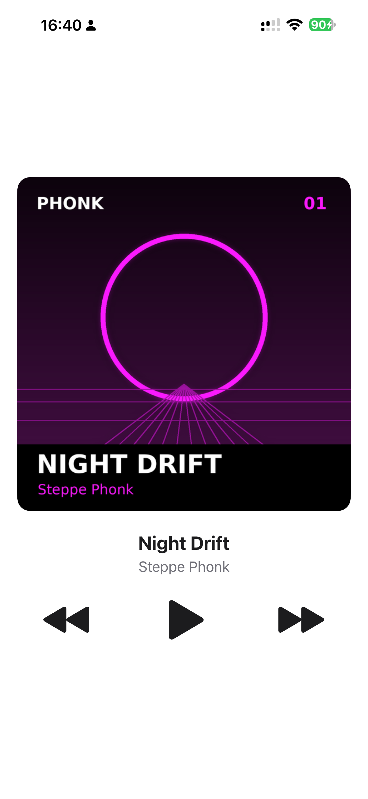

# Lab 8 · Music Player

A single-screen music player in UIKit: cover, title, artist and Previous / Play-Pause / Next controls that play audio files bundled with the app.

## Layout

All layout is in `Main.storyboard`, no layout code:

- **Root Stack** (vertical, spacing 24): Cover, Labels Stack, Controls Stack
- **Labels Stack** (vertical, spacing 4): title and artist
- **Controls Stack** (horizontal, Fill Equally, spacing 16): Previous, Play/Pause, Next

Constraints are only used to place the root stack (20 pt leading/trailing to the Safe Area, vertically centered) and to keep the cover square (1:1 aspect ratio).

## Playback

- 10 songs described by a `Track` struct and stored in one place, `TrackLibrary`
- Audio is loaded with `Bundle.main.url(forResource:withExtension:)` and played with `AVAudioPlayer`
- Next / Previous wrap around and keep the play state
- When a track finishes, the next one starts (`audioPlayerDidFinishPlaying`)
- A missing or broken file is reported with `print` and never crashes the app

The playlist has 10 songs I like: Ariana Grande, Yeat, Электроптицы, Calvin, Tame Impala, TYRANT, Guns N' Roses, Beach House, CHVRCHES and RÜFÜS DU SOL.

The audio files (`Audio/song01–10.mp3`) and album covers are copyrighted, so they are kept only on my Mac and are not in this repository (see `.gitignore`). To run the player with sound, put ten files named `song01.mp3` … `song10.mp3` into `Audio/` and covers `cover01.png` … `cover10.png` into `Covers.xcassets`.

## Screenshots

| iPhone 15 Plus, real device |
|---|
|  |

Screenshot and recording are taken on my real iPhone 15 Plus (the simulator was too slow on my Mac).

## Demo

[Screen recording](screenshots/demo.mp4): play, pause, next, previous and wrap around.
