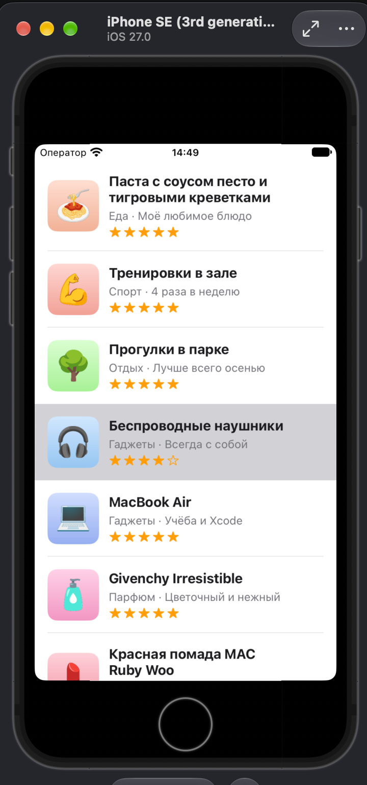

# Lab 9 · Favorites List (Food)

A UIKit app that shows 21 favorite foods in a `UITableView` with a custom cell: image, title, subtitle and a 5-star rating drawn with SF Symbols (`star.fill` / `star`).

## Structure

- `FavoriteItem` — struct with `title`, `subtitle`, `imageName`, `rating` (0–5)
- `FavoritesLibrary` — the array of items, kept in one place
- `FavoriteCell` — `UITableViewCell` subclass with outlets and `configure(with:)`; no layout code
- `ViewController` — `UITableViewDataSource`, one row per item, cells created with `dequeueReusableCell(withIdentifier:for:)`

## Layout (Main.storyboard only)

- The table view fills the Safe Area
- Prototype cell, class `FavoriteCell`, reuse identifier `FavoriteCell`
- Outer horizontal stack: image (64 × 64) + vertical text stack (title, subtitle, rating row)
- Constraints only on the image size and on the outer stack (pinned to the content view margins), so the row height follows the content
- Long title test: "Chicken Tikka Masala with Garlic Naan and Basmati Rice" wraps without overlapping the image

## Screenshots

| iPhone SE (3rd generation) | iPhone 18 Pro Max |
|---|---|
|  |  |

iPhone 18 Pro Max is used instead of iPhone 16 Pro Max, which is not available in the iOS 27 simulator.

## Demo

[Screen recording](screenshots/demo.mov): scrolling through the whole list.

Food images are Noto Color Emoji (Apache 2.0 / OFL) on generated backgrounds.
